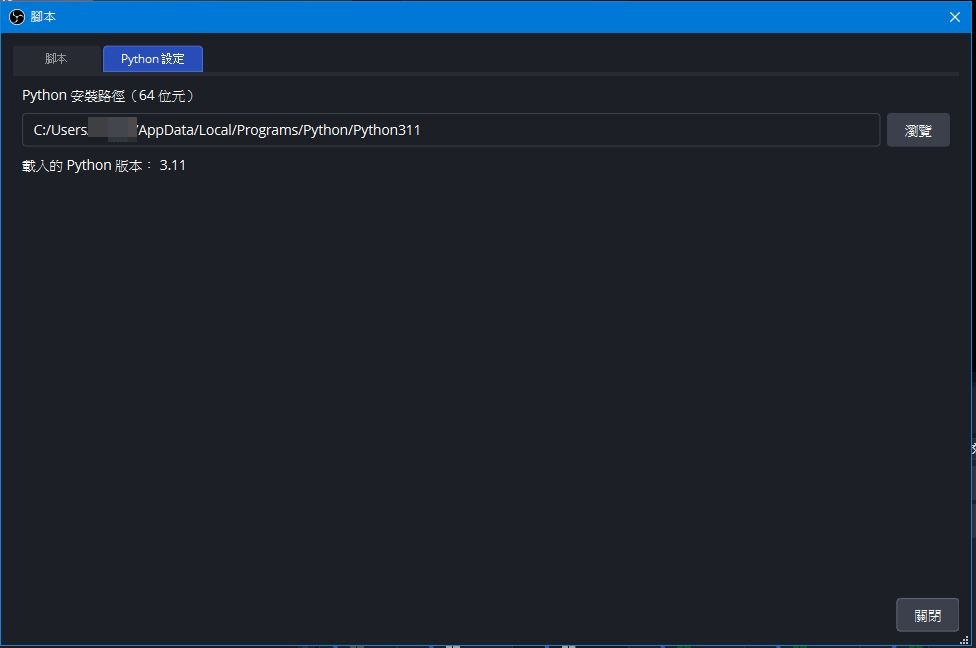
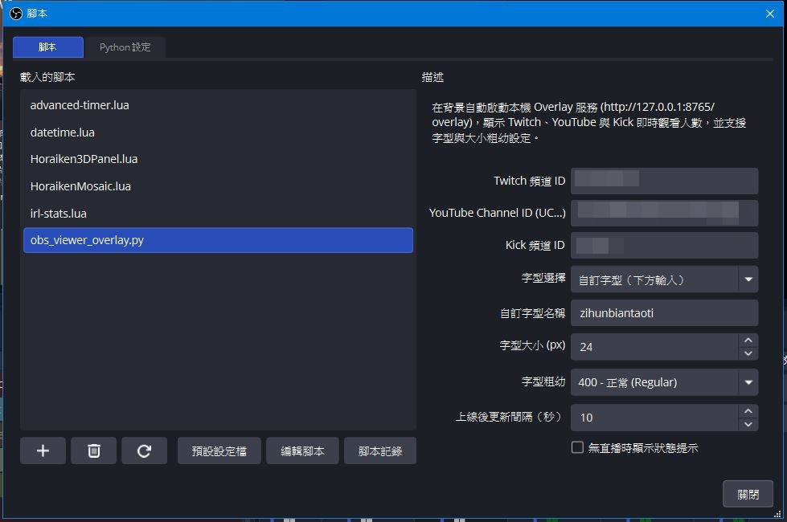
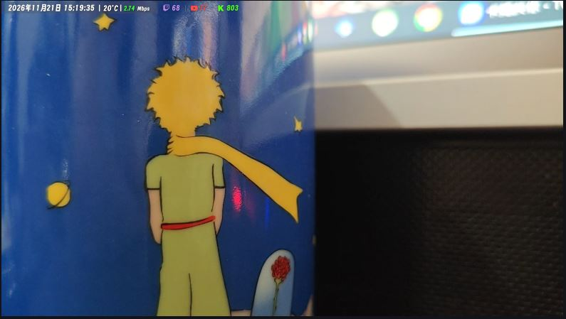

<h1>OBS Viewer Overlay</h1>

Overlay to display Twitch, Youtube, Kick live viewer count in OBS33.
---
  

---

## 功能

- ✔️ **Twitch、Youtube、Kick 觀看人數顯示。**

---

### 使用設定：
1. **下載obs_viewer_overlay.py，新增到OBS腳本。**

2. **到OBS腳本->Python設定 選擇Python exe所在資料夾(C:/Users/用戶名/AppData/Local/Programs/Python/Python311)，建議安裝Python64 3.11。**
**成功後會見到 載入的Python 版本: 3.11**

3. **回到腳本obs_viewer_overlay.py，設定Twitch ID，YoutubeID (UC...)，Kick ID，可設定字型大小等。**

4. **設定OBS Viewer Overlay網址：[http://127.0.0.1:8765/overlay](http://127.0.0.1:8765/overlay) ，並更新一下當前頁面快取。**
   
   
   
  

